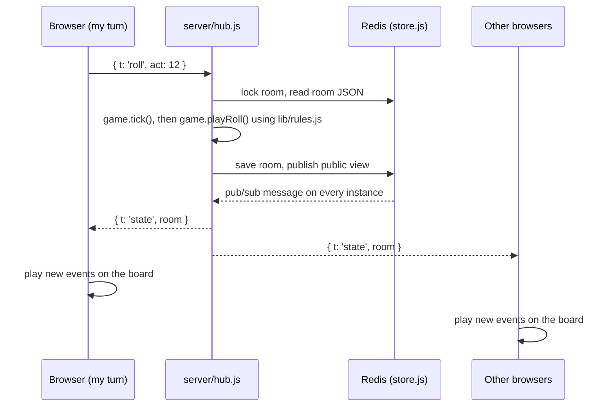

# How The Vaults of Corhaven works

A guide to the code: what it is built with, where each part lives, and how a move travels from a click to every player's board.

## The short version

Corhaven is a 3D Parchís-style board game for two to four kingdoms. The whole player-facing game is **one HTML file** with plain JavaScript and no build step. It draws the board with **three.js**, rolls physical dice with **cannon.js**, and can run in a headset through **WebXR**.

Local play (humans and computer players on one device) runs entirely in the browser. Online rooms add a small **Node** server that holds the real game state, talks to each browser over a **WebSocket**, and stores rooms in **Redis** so any server instance can serve any player. It is deployed on **Vercel**.

The rules live in one shared file, `lib/rules.js`, which both the browser and the server load, so the two can never disagree about what a legal move is.

## Tech stack

| Layer | What we use |
|---|---|
| Page and UI | One HTML file, hand-written CSS, vanilla JavaScript (no framework, no bundler) |
| 3D | three.js r128 and `OrbitControls`, served as local files |
| Dice physics | cannon.js |
| XR | WebXR (`immersive-ar` passthrough when supported, otherwise `immersive-vr`) |
| Sound | `<audio>` for the theme, Web Audio for effects, files in `assets/Music/` |
| Fonts | Google Fonts: Pirata One for titles, Alegreya for body text |
| Server | Node 24, ES modules, the `ws` package for WebSockets |
| Storage | Redis (Upstash) through `ioredis`, or an in-memory store when no Redis URL is set |
| Hosting | Vercel: static files plus three functions in `api/` |
| Tests | Node's built-in test runner (`node --test`) |

The only npm dependencies are `ws` and `ioredis`. Everything the browser needs is checked into the repo.

## Where everything is

```
v3/
├── The Vaults of Corhaven.html   The game. Markup, CSS and all client code.
├── The Vaults of Corhaven_files/ Third-party browser libraries (three.js, OrbitControls, cannon.js, font CSS)
├── lib/
│   ├── rules.js                  Shared rules: board, legal moves, captures, the mist schedule, computer player, adaptive dice
│   └── siege-fx.js               The board effects. Only the mist plays in a match; tide, lava, vines and light stay for the marker lab
├── server/
│   ├── hub.js                    WebSocket message handling, room locking, fan-out to connected players
│   ├── game.js                   Authoritative online game: lobby, turn order, turns, timers, forfeits
│   ├── store.js                  Room storage: Redis, or memory for local play
│   ├── metrics.js                Match records for the dashboard
│   ├── auth.js                   Password cookie for the dashboard
│   ├── http.js                   Small request helpers (body, cookies, IP)
│   └── dashboard.html            The private match-records page
├── api/                          Vercel functions (thin wrappers around server/)
│   ├── ws.js                     /api/ws — the WebSocket endpoint
│   ├── metrics.js                /api/metrics — POST a match record, GET the summary
│   └── dashboard.js              /dashboard — the password-gated records page
├── scripts/
│   ├── local.js                  Serves the game, the WebSocket and the API on one port for local testing
│   └── sync-case-study-screenshots.sh  Copies browser screenshots into docs/case-study/screenshots/
├── test/                         Server and rules tests
├── assets/Music/                 Theme and sound effects
├── style-guide.html              Interface inventory: every component and state, as a live page
├── marker-lab.html               Symlink to the game. Opens a lab board for comparing landing marks
├── docs/                         Case study, development log, visual archive and screenshots
├── vercel.json                   Routes / to the game and /dashboard to its function
└── .cursor/rules/                Project rules for the agent (versioning, no cards, case-study captures)
```

`The Vaults of Corhaven_files/` also holds `saved_resource.html`, `saved_resource(1).html` and `frame-shell-*.js`. These came from saving the page out of a browser and nothing loads them.

## The game file

`The Vaults of Corhaven.html` is about 4,900 lines in three parts:

1. **Head (lines 1–384).** A tiny script that starts the theme music as early as possible, then all of the CSS. Colors and spacing are CSS custom properties in `:root`.
2. **Markup (about 385–703).** The `<canvas id="scene">` for the board, then the HUD and every overlay: title, Create/Join a room (`#online`), Play local (`#setup`), tutorial (`#lesson`), rules, about, settings, leave and win.
3. **Script (704 to the end).** Loads three.js, cannon.js, `lib/rules.js` and `lib/siege-fx.js`, then one large inline script.

The inline script is split into sections with banner comments, so searching for `/* =====` jumps between them:

| Section | What it does |
|---|---|
| Board definition | The Parchís layout: the 68-square track, home stretches, kingdoms (`HOUSES`), positions on the board |
| Renderer / scene, Physics world | three.js scene, camera, lights; the cannon.js world the dice fall in |
| Textures, Materials, Board, Castles | Drawn textures, the wooden board, the four castles and their yards |
| Dice, Pieces, Animation helpers | Dice meshes, troop meshes, and a small promise-based tween helper (`animate`) |
| Sound | Theme and effect playback, volume settings saved in `localStorage` |
| Game rules | The client game state `S`, the online connection state `NET`, metrics reporting, the one-hour match limit |
| Layout, UI | Responsive layout, HUD rendering, toasts, banners, menus, the title version label |
| Dice rolling, Turn flow | Rolling, choosing a die and a troop, moving, captures, doubles, the computer's turn, winning |
| Setup | Play local: number of kingdoms, human or computer for each, the mist on or off, ranked play on or off |
| Tutorial | The guided lesson that walks through leaving the keep, order, doubles and the mist |
| Online rooms | Socket connection, reconnects, the connection banner, Create/Join, the lobby, and the online match |
| Input | Pointer and keyboard handling on the board |
| The March | The mist: its arrival and lifting banners, the board effect, and the veil that hides distant enemies |
| Theme, Loop | Theme timing and the main `requestAnimationFrame` loop |
| WebXR room | Placing the board on a real surface, sizing it, controller and hand input, the in-headset panel |

Two objects hold most of the client state:

- **`S`** is the match: players, whose turn it is (`cur`), the phase (`roll`, `choose`, `moving`, `over`…), the dice waiting to be used (`pending`), whether the mist is up (`world`), and in a ranked match the kingdoms placed so far (`places`).
- **`NET`** is the online connection: the socket, the room code, which kingdom is mine (`myH`), the last server event shown (`seen`), and any action waiting for the server to confirm.

`GAME_VERSION` near the top of the script is the version shown on the title screen. See `.cursor/rules/game-version.mdc` for when to bump it.

## The shared rules (`lib/rules.js`)

This file is written so it runs unchanged in both places. In the browser it is a plain `<script>`; on the server `game.js` imports it for its side effect. Either way it puts everything on `globalThis.CorhavenRules`.

A troop is `{h, idx, p}`: kingdom 0–3, troop 0–3, and progress. Progress `-1` is the keep, `0..63` is the shared road, `64..70` is the kingdom's own passage, and `71` is the vault. A troop carried by the Stones of the Pact onto a square its own road does not number also has `at`, a raw track index.

The important functions:

- `moveResult` and `options` work out every legal move for a set of dice, including blockades, safe squares, captures, the World Event's +2 blessing, and stone hops.
- `phalanxDouble` handles a double opening a barricade.
- `bestOption` and `cpuScore` are the computer player. It scores each move (reaching the vault, capturing, leaving the keep, getting to safety, avoiding danger) and picks the highest.
- `adaptRoll` is adaptive dice. After two turns with no legal move it quietly weights faces that would allow a move, with no face above 30%. Endgame help exists but is switched off in `ADAPT`.
- `worldAfter(rounds)` is the mist schedule: it comes down after every third round (`MIST_EVERY`) and lifts after the next. `WORLD` still defines all six events, so the +2 blessing and the stones stay tested, but only the mist is ever dealt.
- `allHome` says whether a kingdom has every troop in the vault. In a ranked match that places it and play goes on.

Change a rule here and both local and online play change together. `test/game.test.js` covers most of it.

## Local play

Everything happens in the browser. **Play local** calls `newGame` with the chosen kingdoms. Each turn runs through the Turn flow section: `doRoll` throws physical dice and reads their faces, the player (or `bestOption` for a computer) chooses a move, and the troop animates along the road. Nothing goes to a server except an anonymous match record (see Metrics).

## Online play

The server owns the game. Browsers send intentions; the server decides what happened and tells everyone.



**The messages.** Each browser keeps a random player id in `sessionStorage` and opens `wss://…/api/ws`. It sends `browse` (watch open rooms), `create`, `join`, then in the lobby `name`, `pick` (a kingdom), `opts` (host only: private room, the mist, ranked play) and `start`. During the match it sends `roll`, `move`, `away`, `back` and `leave`. The server answers with `rooms`, `joined`, `state` and `error`. Error codes map to player-facing text in `ROOM_ERRORS` in the game file.

**One change at a time.** `hub.js` runs every change through `mutate(code, fn)`. It takes a short Redis lock on the room, loads it, calls `game.tick` to apply anything that came due, applies the change, saves the room, and publishes the public view. Every server instance subscribed to that room forwards it to the sockets it holds. This is why players on different Vercel instances still see the same game.

**Events, not just snapshots.** `game.js` appends each step (order roll, roll, move, no move, the end of a round with the mist's state, a ranked finish, forfeit) to `room.events` with an increasing `seq`, keeping the last 40. The browser plays any events newer than `NET.seen` through `playEvent`, so remote moves animate the same way local ones do. If it has fallen too far behind, or missed events, it jumps straight to the snapshot with `snapTo` instead of replaying.

**Timers.** A turn lasts 20 seconds (`TURN_MS`), counted from when the board has finished animating; `eventMs` estimates how long each event takes to show. When the clock runs out, `tick` rolls or moves for the player using the computer's choice. A player who is away for a minute (`AWAY_MS`) forfeits. A match closes after an hour. Each instance sets a timer for the room's `nextDue` time so this happens even when nobody acts.

**What leaves the server.** `publicView` strips private ids. Seat ids act as passwords, so other players only ever see a public `pid`.

**Reconnects.** Vercel closes a WebSocket at five minutes, so the client opens a fresh one at about four minutes and rejoins the room. The server waits two seconds before marking a dropped player away, so the swap is invisible. If a connection truly drops, the client retries with backoff and shows the connection banner.

**Starting together.** When a match starts the server sets `themeAt`. Every device shows a short gate and starts the theme at that same server instant, corrected by the clock offset each message carries in `now`.

**Storage.** `store.js` uses Redis when `REDIS_URL` or `KV_URL` is set: rooms are JSON under `corhaven:room:CODE`, open lobbies are a set, and changes go out over pub/sub. Rooms expire after six hours, or ten minutes once closed or finished. Without a Redis URL it falls back to an in-memory store with the same interface, which is enough for one machine.

## Metrics and the dashboard

When a match starts and ends, the browser POSTs an anonymous record to `/api/metrics`: mode, kingdoms, humans versus computers, winner, turns, doubles, World Events seen, and device type. Online matches are also recorded by the server. `server/metrics.js` sanitizes and merges the records in Redis, keeping the last 2,000 for 180 days, and rate-limits by IP.

`/dashboard` shows the summary. It is gated by `DASHBOARD_PASSWORD` through a signed cookie (`server/auth.js`). In production without a password set, the page returns 404.

## Running it

| Goal | Command | Notes |
|---|---|---|
| Play local, tutorial, UI work | `python3 -m http.server 8765` | Open `http://127.0.0.1:8765/`. Online rooms will not work. |
| Everything, including online rooms and the dashboard | `npm install` then `npm run local` | `http://localhost:3000`. Rooms live in memory unless `.env.local` sets `REDIS_URL`. Open two windows to play yourself. |
| Tests | `npm test` | Runs `test/*.test.js` with Node's test runner |

Opening the HTML file directly from disk works for local play; online rooms need the page served over `http` or `https`.

**Environment variables** (see `.env.example`):

- `REDIS_URL` or `KV_URL` — Redis connection. Required in production so instances share rooms.
- `DASHBOARD_PASSWORD` — opens `/dashboard`.

**Deploying.** The repo is a Vercel project. `vercel.json` rewrites `/` to the game file and `/dashboard` to its function. Files in `api/` become functions; everything else is served as static files.

## Tests

- `test/game.test.js` drives `server/game.js` and `lib/rules.js` directly: lobby rules, a full game to a winner, illegal moves, idle timers, leavers, forfeits, the hour limit, the blessing, the stones, the computer's choices, the mist schedule, ranked places, turn order and ties, doubles, adaptive dice, and protection against a repeated roll.
- `test/metrics.test.js` covers record sanitizing, merging, summaries, abandoned matches, and test-match exclusion.

There are no browser tests. UI changes are checked by hand and captured for the case study.

## Docs and design references

- `style-guide.html` is the live interface inventory: tokens, type, buttons, banners, overlays and HUD states.
- `docs/case-study-development-log.md` is the timeline of decisions and playtests.
- `docs/case-study/visual-archive.md` indexes the screenshots in `docs/case-study/screenshots/`.

## Where to make common changes

| I want to… | Look in |
|---|---|
| Change a rule, legal move or capture | `lib/rules.js`, then run `npm test` |
| Change how the computer plays | `cpuScore` in `lib/rules.js` |
| Change when the mist comes | `MIST_EVERY` and `worldAfter` in `lib/rules.js`, and `eventMs` in `server/game.js` |
| Change ranked play | `placeKingdom` in `server/game.js` and in the Turn flow section of the game file |
| Change online timers or room limits | Constants at the top of `server/game.js` and `server/store.js` |
| Add an online action | A case in `handle` in `server/hub.js`, a function in `server/game.js`, and a `sendAction` plus a `playEvent` case in the game file |
| Change a screen or overlay | Its markup in the game file, its CSS in the `<style>` block, and its handlers in the UI, Setup or Online rooms section |
| Change colors or type | `:root` custom properties in the game file, and keep `style-guide.html` in step |
| Change sounds | `assets/Music/` and the Sound section of the game file |
| Bump the version | `GAME_VERSION` in the game file |
